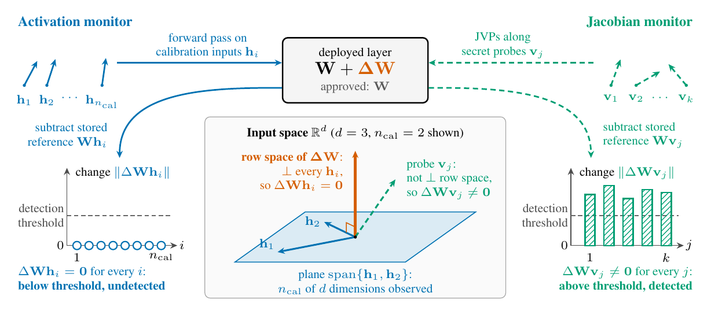
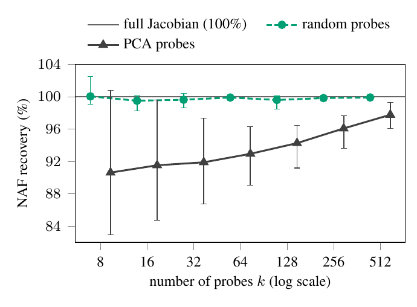

# Activation Monitoring Has a Provable Blind Spot: A Jacobian-Based Fix for LLM Integrity

[](LICENSE)


Code, configurations and result files for the paper
**"Activation Monitoring Has a Provable Blind Spot: A Jacobian-Based Fix for LLM Integrity"**
by Erhan Arslan and Naveed Islam.

An auditor who wants to check that a deployed large language model still equals its approved
version often compares hidden activations on a fixed set of calibration prompts. We show that
this check has a structural blind spot, train a working backdoor inside it, and propose the
**tap test**: a check that reads the layer Jacobian along a few secret random directions.

<p align="center">
  
</p>

*An edit ΔW whose rows are orthogonal to the n<sub>cal</sub> calibration inputs h<sub>i</sub>
leaves their outputs unchanged (left), while Jacobian-vector products along secret random probes
v<sub>j</sub> expose the same edit (right).*

---

## Contents

- [The idea in one example](#the-idea-in-one-example)
- [Main results](#main-results)
- [Repository structure](#repository-structure)
- [Installation](#installation)
- [Reproducing the experiments](#reproducing-the-experiments)
- [Statistical analysis](#statistical-analysis)
- [Scope and known limitations](#scope-and-known-limitations)
- [Citation](#citation)
- [License](#license)

## The idea in one example

For a linear sublayer **y = W h**, a weight edit changes the output on calibration input
**h**<sub>i</sub> by **ΔW h**<sub>i</sub>. With

```
ΔW = [[1,  0, -1],        h1 = (1, 2, 1)   ->  ΔW h1 = (0, 0)   activation check sees no change
      [1, -1,  1]]        v1 = (2,-1, 1)   ->  ΔW v1 = (1, 4)   Jacobian probe sees the edit
```

every row of ΔW is orthogonal to the calibration input, so the activation check reports no
change, although the layer has changed. The Jacobian of a linear sublayer is **W** itself, so
its change is ΔW, and a random probe direction v reveals it almost surely. With hidden size
d = 2048 and n<sub>cal</sub> = 20 calibration prompts, at least 2028 of the 2048 input
directions are never observed by the calibration set.

The tap test stores, at approval time, the Jacobian-vector products (JVPs) of each monitored
layer along k secret random orthonormal directions on every calibration prompt, and tests at
audit time whether the served model still reproduces them. With k = 8 it needs 256 to 512 times
fewer JVPs than the full Jacobian for the hidden sizes of the tested models.

**When to use it.** If the weight files can be read, hashing them is simpler and stronger. With
text-only API access, neither activation nor Jacobian monitoring is possible. The tap test targets
auditors in between: they can query hidden states and layer derivatives of the served model but
cannot read its weight files.

## Main results

All numbers below come from the files in [`results/`](results/) and are reported in the paper.

**Synthetic null-space edits** (tap test, k = 8; NAF measures how strongly the null-space
structure favors the Jacobian over the activation monitor, relative to a norm-matched Gaussian
edit):

| Model | Sublayer | d | n<sub>cal</sub> | NAF at ε = 0.05 [95% bootstrap interval] | Activation monitor evaded | Jacobian detected |
|---|---|---:|---:|---|---:|---:|
| Llama-3.2-1B | `gate_proj` | 2048 | 30 | 7.11 [6.50, 7.72] | 15/15 | 15/15 |
| Llama-3.2-3B | `gate_proj` | 3072 | 20 | 5.91 [5.36, 6.46] | 12/12 | 12/12 |
| Llama-3.1-8B | `gate_proj` | 4096 | 20 | 5.76 [5.04, 6.49] | 11/12 | 12/12 |
| Qwen2.5-7B | `gate_proj` | 3584 | 20 | 5.48 [5.01, 5.96] | 12/12 | 12/12 |
| Mistral-7B-v0.3 | `gate_proj` | 4096 | 20 | 5.24 [4.75, 5.73] | 10/12 | 12/12 |
| Llama-3.2-1B | `q_proj` | 2048 | 20 | 2.59 [2.33, 2.88] | 10/15 | 15/15 |

- Together with the five edited layers of the null-space backdoor, the experiments contain
  **83 null-space conditions**. The Jacobian detects **all 83**; in **71** of them the activation
  signal of the edited layer on the calibration prompts is below half that of an equal-size
  random edit (the evasion criterion used throughout).
- A backdoor trained with its weight update projected onto the calibration null space after every
  optimizer step reaches **100% trigger success**. At its first edited layer its activation change
  is **80% smaller** than that of an equal-size random edit, and the Jacobian detects it at every
  edited layer.
- The blind spot is specific to the calibration prompts: on held-out prompts the activation signal
  of a null-space edit is suppressed by only 19%, 28% and 29% at ε = 0.01, 0.05 and 0.1.

**Number of probes.** Eight random orthonormal probes recover the NAF of the full Jacobian
(mean 100.05%, range 99.10–102.53%); probes taken from the principal directions of the approved
Jacobian recover less at every k.

<p align="center">
  
</p>

**Cost** (one NVIDIA H200, Llama-3.2-1B, per prompt, mean over five prompts): activation monitor
9.27 ms and tap test (k = 8) 47.35 ms, both over five monitored layers; full Jacobian 162.1 ms for a
single layer (layer 12). The scopes differ, so these times are not compared as ratios.

## Repository structure

```
jacobian-llm-integrity/
├── src/                  Shared library used by Experiments 2–11
│   ├── model_loader.py     model loading (bfloat16, eager attention, JVP-compatible)
│   ├── data_loader.py      WikiText-103 prompt sampling and calibration/test splits
│   ├── layer_wrapper.py    hooks for hidden states and layer outputs at the last token
│   ├── jvp_engine.py       full Jacobian and tap-test JVPs via torch.func (jvp + vmap)
│   ├── perturbations.py    Gaussian and null-space weight edits, projection, restore
│   ├── metrics.py          relative activation and Jacobian statistics, t-tests, NAF
│   └── baselines.py        SHA-256 hash, weight L2 distance, cost measurements
├── configs/              YAML configuration for every experiment
├── experiments/          One script per experiment (run_step1 … run_step11)
├── results/              Stored outputs of every run used in the paper (JSON, logs)
├── analysis/             Statistical analysis over all stored results
├── pilot/                Experiment 1 (pilot study) with its own code, configs and tests
├── docs/
│   └── EXPERIMENTS.md      How the study developed, experiment by experiment
└── assets/               Figures used in this README
```

The step-by-step account of the eleven experiments (the question each one asked, its setup, its
result, and how it led to the next) is in [`docs/EXPERIMENTS.md`](docs/EXPERIMENTS.md). An index of
every results folder is in [`results/README.md`](results/README.md).

## Installation

```bash
git clone https://github.com/ErhanArslanCSE/jacobian-llm-integrity.git
cd jacobian-llm-integrity
python -m venv .venv && source .venv/bin/activate
pip install -r requirements.txt
```

The Llama models are gated on the Hugging Face Hub. Accept their license on the model pages and
log in once with `huggingface-cli login`; never commit an access token to the repository.

All experiments in the paper were run on a single NVIDIA H200 GPU.

## Reproducing the experiments

Run every script from the repository root as a module, so that `src/` is importable:

```bash
python -m experiments.run_step2_nullspace --config configs/nullspace.yaml
```

| # | What it tests | Command (from the repository root) | Stored results |
|---|---|---|---|
| 1 | Pilot: Jacobian vs. activation signal-to-noise | see [`pilot/README.md`](pilot/README.md) | [`results/pilot/`](results/pilot/) |
| 1b | Re-analysis of the pilot with corrected statistics | `python -m experiments.run_step1_reanalysis` | printed summary |
| 2 | Null-space edits on Llama-3.2-1B `gate_proj` | `python -m experiments.run_step2_nullspace --config configs/nullspace.yaml` | [`results/step2_eval_v2_fixed/`](results/step2_eval_v2_fixed/) |
| 3 | Calibration-set size sweep (n<sub>cal</sub> = 10 to 100) | `python -m experiments.run_step3_cal_sweep --config configs/nullspace.yaml` | [`results/step3_cal_sweep/`](results/step3_cal_sweep/) |
| 4 | Five layers × three edit sizes | `python -m experiments.run_step4_multi_layer --config configs/multi_layer.yaml` | [`results/step4_multi_layer/`](results/step4_multi_layer/) |
| 5 | Standard fine-tuned backdoor | `python -m experiments.run_step5_backdoor --config configs/backdoor.yaml` | [`results/step5_eval_20260226_220101/`](results/step5_eval_20260226_220101/) |
| 6 | Backdoor trained inside the null space | `python -m experiments.run_step6_nullspace_backdoor --config configs/nullspace_backdoor.yaml` | [`results/step6_nullspace_backdoor/`](results/step6_nullspace_backdoor/) |
| 7 | Tap test vs. full Jacobian; k = 8 to 512; random vs. PCA probes | `python -m experiments.run_step7_tap_test --config configs/tap_test.yaml` | [`results/step7_eval_20260227_011659/`](results/step7_eval_20260227_011659/) |
| 8 | Scale: Llama-3.2-3B and Llama-3.1-8B | `python -m experiments.run_step8_scale_test --config configs/scale_test_3b.yaml` (and `scale_test_8b.yaml`) | [`results/step8_scale_test_3b/`](results/step8_scale_test_3b/), [`results/step8_scale_test_8b/`](results/step8_scale_test_8b/) |
| 9 | Baselines: activation, hash, weight L2, tap test, full Jacobian | `python -m experiments.run_step9_baselines --config configs/baselines.yaml` | [`results/step9_baselines/`](results/step9_baselines/) |
| 10 | Other families: Qwen2.5-7B and Mistral-7B-v0.3 | `python -m experiments.run_step10_cross_architecture --config configs/cross_arch_qwen25_7b.yaml` (and `cross_arch_mistral_7b.yaml`) | [`results/step10_cross_arch_qwen25_7b/`](results/step10_cross_arch_qwen25_7b/), [`results/step10_cross_arch_mistral_7b/`](results/step10_cross_arch_mistral_7b/) |
| 11 | Attention sublayer `q_proj` | `python -m experiments.run_step11_attention_layer --config configs/attention_q_proj.yaml` | [`results/step11_attention_q_proj/`](results/step11_attention_q_proj/) |

Each run writes to the folder named in `output.dir` of its config; re-running a step may overwrite
stored outputs. All runs use seed 42.

**Decision rule used in all experiments.** For every prompt the scripts compute, at the last token,
the relative activation change ‖Δh‖/‖h‖ and the relative tap statistic
‖(J − J<sub>ref</sub>)V‖<sub>F</sub> / ‖J<sub>ref</sub>V‖<sub>F</sub>. A monitor flags a change when
a one-sided one-sample t-test over the calibration prompts rejects a zero mean at α = 0.001 (two
runs of an unmodified model give exactly zero difference in this setup). An activation monitor
counts as *evaded* when its calibration signal is below 50% of that of a Gaussian edit of the same
Frobenius norm.

## Statistical analysis

```bash
python analysis/statistical_analysis.py
```

recomputes the normality checks, Wilcoxon tests, Bonferroni correction, bootstrap intervals and
effect sizes over the stored results and writes
[`analysis/statistical_results.json`](analysis/statistical_results.json).

## Scope and known limitations

- Models up to 8B parameters, all with SiLU gated MLP sublayers; edits of `gate_proj` (five models)
  and `q_proj` (one model).
- Only the relative-L2 activation statistic was measured. Probes and sparse autoencoders trained on
  activations, activation monitors on held-out or secret prompts, and an adversary who also targets
  the Jacobian were not evaluated.
- The raw JSON output of Experiment 6 was not saved; its tables are transcribed from the run report
  in [`results/step6_nullspace_backdoor/README.md`](results/step6_nullspace_backdoor/README.md).
- `requirements.txt` lists minimum versions; the exact package versions of the original runs were
  not recorded.
- JVPs through `torch.func` need eager attention and no key-value cache, so the tap test is meant
  for periodic audits on a dedicated instance rather than inside an optimized serving stack.

## Citation

If you use this code, please cite the paper:

```bibtex
@misc{arslan2026activation,
  title        = {Activation Monitoring Has a Provable Blind Spot: A Jacobian-Based Fix for {LLM} Integrity},
  author       = {Arslan, Erhan and Islam, Naveed},
  year         = {2026},
  howpublished = {\url{https://github.com/ErhanArslanCSE/jacobian-llm-integrity}}
}
```

GitHub also offers a "Cite this repository" button based on [`CITATION.cff`](CITATION.cff).

## License

The code in this repository is released under the [MIT License](LICENSE). The models used in the
experiments (Llama 3.x, Qwen2.5, Mistral-7B-v0.3) and the WikiText-103 dataset are subject to their
own licenses and are not redistributed here.
