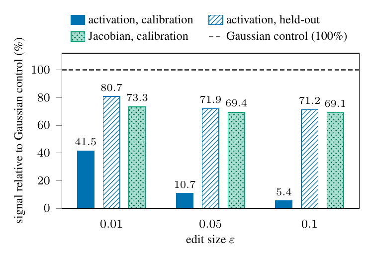

# Activation Audits on Fixed Prompts Have a Null-Space Blind Spot: Secret Jacobian Probes for LLM Weight Integrity

[](LICENSE)


Code, configurations, pre-registrations and result files for the paper
**"Activation Audits on Fixed Prompts Have a Null-Space Blind Spot: Secret Jacobian Probes for LLM
Weight Integrity"** by Erhan Arslan, Naveed Islam and William Puech (under review).

Anyone with write access to a deployed large language model's weights can implant a backdoor, so
the served model must be verified against the approved one. An auditor who can query the model's
internals but cannot read its weights would naturally compare activations on fixed calibration
prompts with values recorded at approval. We prove that this check has a blind spot, show that an
adversary who knows the prompts can hide a working backdoor in it, and propose the **tap test**,
which measures each layer's Jacobian, the derivative that contains the weight change, along eight
secret random directions. Without the weights, an auditor needs secret probes, not fixed, known
prompts.

<p align="center">
  
</p>

*An edit ΔW whose rows are orthogonal to the n<sub>cal</sub> calibration inputs h<sub>i</sub>
leaves the sublayer's outputs on these inputs unchanged (left), while Jacobian-vector products
along secret random probes v<sub>j</sub> expose the same edit (right).*

---

## Contents

- [The idea in one example](#the-idea-in-one-example)
- [Who the tap test is for](#who-the-tap-test-is-for)
- [Main results](#main-results)
- [Experiments](#experiments)
- [Repository structure](#repository-structure)
- [Installation](#installation)
- [Reproducing the experiments](#reproducing-the-experiments)
- [Decision rules and terms](#decision-rules-and-terms)
- [Scope and limitations](#scope-and-limitations)
- [Responsible use](#responsible-use)
- [Citation](#citation)
- [License](#license)

## The idea in one example

For a linear sublayer **y = W h**, a weight edit changes the output on calibration input
**h**<sub>i</sub> by **ΔW h**<sub>i</sub>. With

```
ΔW = [[1,  0, -1],        h1 = (1, 2, 1)   ->  ΔW h1 = (0, 0)   activation check sees no change
      [1, -1,  1]]        v1 = (2,-1, 1)   ->  ΔW v1 = (1, 4)   Jacobian probe sees the edit
```

every row of ΔW is orthogonal to the calibration input, so the activation check reports no
change, although the layer has changed. The Jacobian of a linear sublayer is **W** itself, so its
change is ΔW, and a random probe direction v reveals it almost surely. With hidden size d = 2048
and n<sub>cal</sub> = 20 calibration prompts, at least 2028 of the 2048 input directions are never
observed by the calibration set.

The tap test stores, at approval time, the Jacobian-vector products (JVPs) of each monitored layer
along k secret random orthonormal directions on every calibration prompt, and checks at audit time
whether the served model still reproduces them. With k = 8 it evaluates d/k = 256 to 512 times
fewer JVPs than the full Jacobian for the hidden sizes of the tested models.

**Where the blind spot ends.** The guarantee holds at the last token, on the calibration prompts
and in exact arithmetic. A null-space edit still changes the edited layer's output at earlier token
positions, and later layers attend to them, so an activation audit of every layer sees a
single-layer edit on a deterministic stack (RQ1 below). An adversary who knows the prompts can
shrink this leak by also avoiding the inputs at earlier positions (the all-position adversary, AP),
and the leak that remains is of the order of the numerical noise that audits on other GPU
architectures must tolerate (RQ2 and RQ4).

## Who the tap test is for

| Access to the served model | Check |
|---|---|
| (i) The weight files can be read | Hashing them is simpler and stronger than either monitor |
| (ii) Only generated text | Neither activation nor Jacobian monitoring applies |
| (iii) Prompts in, hidden states and JVPs of a decoder layer out, through an inference interface; weight files not readable, arbitrary hidden states not accepted as layer inputs | **Tap test** (this paper) |

The auditor of setting (iii) fixes the calibration prompts and draws the secret probe matrix at
approval, stores the reference activations and probe responses, and audits the served model at
unpredictable times through the inference interface. The adversary knows the weights, the
calibration prompts, the monitored layers and the decision rules, and may know the distribution of
the auditor's secret prompts, but not the probe matrix, the stored probe responses or the secret
prompts themselves.

## Main results

The paper answers five research questions (RQs). All numbers below are reported in the paper and
come from the result files of the experiments listed under [Experiments](#experiments).

### RQ1: Single-layer null-space edits

Synthetic null-space edits (L3) at the edited layer, tap test with k = 8:

| Model | Sublayer | d | NAF at ε = 0.01 | ε = 0.05 | ε = 0.1 | Suppression (%) | Tap test detects |
|---|---|---:|---:|---:|---:|---|---:|
| Llama-3.2-1B | `gate_proj` | 2048 | 1.89 | 7.11 | 14.05 | 54.9 to 95.1 | 15/15 |
| Llama-3.2-3B | `gate_proj` | 3072 | 1.75 | 5.91 | 11.41 | 52.4 to 94.2 | 12/12 |
| Llama-3.1-8B | `gate_proj` | 4096 | 1.68 | 5.76 | 11.03 | 49.0 to 94.2 | 12/12 |
| Qwen2.5-7B | `gate_proj` | 3584 | 1.60 | 5.48 | 10.30 | 53.8 to 94.2 | 12/12 |
| Mistral-7B-v0.3 | `gate_proj` | 4096 | 1.60 | 5.24 | 10.27 | 48.2 to 93.4 | 12/12 |
| Llama-3.2-1B | `q_proj` | 2048 | 1.19 | 2.59 | 4.76 | 26.5 to 86.9 | 15/15 |

Calibration prompts: 30 for the first row, 20 otherwise. NAF: mean over the four or five edited
layers. Suppression: range over the edited layers and the three sizes, bfloat16.

- In float32 the suppression at the edited layer is above 99.99% in all 15 Llama-3.2-1B
  conditions, as the theorem predicts. In bfloat16 it is 54.9 to 61.1%, 87.8 to 90.6% and 94.1 to
  95.1% at ε = 0.01, 0.05 and 0.1; the residual comes from rounding W + ΔW to bfloat16 (about
  1.7 × 10<sup>-3</sup> of ‖W‖<sub>F</sub>), not from the edit.
- The later layers see the edit. In float32 and in bfloat16 the activation t-test rejects at every
  layer from the edited one on, in all 15 conditions, so an activation audit of every layer detects
  all 15 single-layer edits on a deterministic stack.
- The tap test detects all 78 conditions, every p-value below 10<sup>-12</sup>. With 10 to 100
  calibration prompts the full Jacobian detects every layer-12 edit, with NAF 6.49 to 6.93 at
  ε = 0.05.

<p align="center">
  
</p>

*At the edited layer (Llama-3.2-1B `gate_proj`, layer 12, 30 calibration and 30 held-out prompts)
the null-space edits remove most of the activation signal on the calibration prompts but keep 71
to 81% of it on held-out prompts, while their Jacobian signal (full Jacobian) on the calibration
prompts stays at 69 to 73% of that of an equal-size random edit.*

### RQ2: Adaptive adversaries against an audit of every layer

Trained backdoors on Llama-3.2-1B `gate_proj` (layers 2, 6, 10, 12 and 14; one layer: layer 2),
bfloat16, six runs per variant:

| Adversary | Functional | Masked on calibration | Masked on held-out | Worst-layer mean s<sub>act</sub> | Tap test detects |
|---|---:|---:|---:|---|---:|
| L1 | 6/6 | 0/6 | 0/6 | 0.497 to 1.073 | 6/6 |
| L2, L2R | 12/12 | 0/12 | 0/12 | 0.126 to 0.353 | 12/12 |
| AP | 20/24 | 14/20 | 0/20 | 0.013 to 0.037 | 24/24 |
| L2, one layer | 6/6 | 0/6 | 0/6 | 0.083 to 0.409 | 6/6 |
| AP, one layer | 9/12 | 4/9 | 0/9 | 0.013 to 0.041 | 12/12 |

- Synthetic AP edits are masked at every layer in float32 in all 45 conditions for each number of
  directions m from 64 to 1024.
- The functional AP backdoors keep the model's text: held-out perplexity 29.3 to 33.8, against
  32.84 for the clean model. Held-out prompts see every backdoor: no run of any adversary is masked
  on them.
- On Llama-3.1-8B, Qwen2.5-7B and Mistral-7B-v0.3 (m = 1024) all six AP runs are functional and
  five are masked, whereas L2 is functional in all six and masked in none.
- In five scenarios with ordinary trigger phrases and decision labels as markers (incident
  triage, code review, entity screening, product review, assessment), AP backdoors are masked in
  all 10 runs and L2 backdoors in none, at 100% trigger success.
- The tap test rejects at each edited layer in all runs, models and scenarios. On a deterministic
  stack the activation t-test also flags every run; the masking matters once the audit needs a
  tolerance (RQ4).

### RQ3: Jacobian-aware adversary

The Jacobian-aware adversary (JA) trains an AP backdoor that also minimizes the expected tap
statistic, a quadratic form in ΔW that it can compute without the probe matrix. Over 48 JA runs
and 6 plain AP runs on Llama-3.2-1B, the most successful functional and masked JA run keeps 17.3%
of the tap statistic of an equal-size random edit on the calibration prompts (plain AP: 70.6%) and
48.7% on held-out prompts. Penalty weights of 10<sup>3</sup> and above leave no run both functional
and masked. On a deterministic stack the tap test detects all 54 runs and every run on the larger
models.

### RQ4: Decisions under serving noise

On two H200 cards the clean statistics are bitwise identical. Across GPU architectures (H200, B200,
RTX PRO 4500) the clean model deviates: its mean tap statistic reaches 0.9 to 1.5 × 10<sup>-2</sup>
and its activation statistic 2.6 to 3.9 × 10<sup>-2</sup> on single prompts, the same order as the
worst-layer statistic of the AP backdoors. Audits across architectures therefore use a threshold
rule, evaluated with one architecture left out. The equal-budget benchmark gives every activation
monitor the tap test's budget of 270 passes per audit and layer (Llama-3.2-1B, margin c = 1.5,
20 audits per model):

| | A30 | A270k | A270s | S270 | T30 | T30s |
|---|---:|---:|---:|---:|---:|---:|
| Prompts or states | cal. | known | secret | secret | cal. | secret |
| Layers | 16 | 16 | 16 | 5 | 5 | 5 |
| False alarms on the clean model (of 20) | 6 | 6 | 6 | 6 | **0** | **0** |
| Synthetic edits, ε ≥ 0.05 (20 edits, of 400) | 166 | 232 | 252 | 400 | 400 | 400 |
| of which AP edits from the prompt distribution (4, of 80) | 24 | 24 | 24 | 80 | 80 | 80 |
| Backdoor L2 (of 20) | 20 | 20 | 20 | 20 | 20 | 20 |
| Backdoors AP, calibration (3) | 6 | 20 | 20 | 20 | 20 | 20 |
| Backdoor AP, known prompts (1) | 20 | 20 | 20 | 20 | 20 | 20 |
| Backdoors AP, distribution (4) | 6 to 20 | 14 to 20 | 20 | 20 | 20 | 20 |
| Backdoor JA, calibration | 6 | 20 | 20 | 20 | **6** | 20 |
| Backdoors JA, distribution (2) | 6 to 20 | 7 to 20 | 20 | 20 | 20 | 20 |

A: activation monitor; S: activation monitor on synthetic hidden states fed directly to each layer
(needs an interface that setting (iii) does not offer, so an upper bound); T: tap test. 30 or 270:
prompts or states per audit; k: known to the adversary; s: secret. An activation entry of 6 equals
the clean model's count. T30 flags the JA backdoor built from the calibration prompts in 6 of 20
audits, above its own 0 on the clean model.

The tap test on secret prompts (T30s) is the only monitor that an interface of setting (iii) can
run that raised no false alarm and flagged every edited model, including the three Jacobian-aware
backdoors, in all 20 audits.

### RQ5: Number of probes and cost

<p align="center">
  
</p>

- Eight random orthonormal probes recover 100.05% of the full-Jacobian NAF on average (range 99.10
  to 102.53%), and every k from 8 to 512 detects all 15 edits of RQ1. Probes taken from the
  principal directions of the approved Jacobian recover only 90.63% at k = 8 and stay below random
  probes at every k. On the four larger models and `q_proj`, k = 8 gives 99.59 to 101.81% of the
  NAF at k = 64.
- One NVIDIA H200, Llama-3.2-1B, per prompt (mean over five prompts): activation monitor 9.27 ms,
  activation monitor and tap test together 47.35 ms (both over five layers, ratio 5.1); full
  Jacobian 162.1 ms for a single layer. The weight-file checks of setting (i) take 40.05 ms
  (SHA-256) and 67.24 ms (weight distance) for one 8192 × 2048 matrix.

## Experiments

The study ran in nineteen experiments. Experiments 2 to 11 share the library in [`src/`](src/);
Experiments 12 to 19 are self-contained folders under [`experiments/`](experiments/), each with
its own code, tests, configurations and results. Experiments 13 to 19 were pre-registered: the
question, the predictions and the rules for interpreting the outcome were written down in
`PREREGISTRATION.md` before the first run on a real model, and each `RESULTS.md` checks the outcome
against them, failed predictions included.

Experiments 12 to 19 were added after expert feedback on an earlier version of the paper.
Experiment 12 overturned two claims of that version, which counted activation evasion at the
edited layer only; [`docs/EXPERIMENTS.md`](docs/EXPERIMENTS.md) tells the whole development,
experiment by experiment, including that correction. The documents in the folders of Experiments
12 to 19 refer to the section numbers of the earlier version and to the feedback items, and are
kept unchanged as the record of the runs.

| # | Question | Paper | Code and results |
|---|---|---|---|
| 1 | Pilot: is a Jacobian statistic more sensitive than activations? | Development | [`pilot/`](pilot/), [`results/pilot/`](results/pilot/) |
| 2 | Null-space edits at layer 12 of Llama-3.2-1B, full Jacobian, held-out prompts | RQ1 | [`run_step2_nullspace.py`](experiments/run_step2_nullspace.py), [`results/step2_eval_v2_fixed/`](results/step2_eval_v2_fixed/) |
| 3 | Calibration-set size from 10 to 100 prompts | RQ1 | [`run_step3_cal_sweep.py`](experiments/run_step3_cal_sweep.py), [`results/step3_cal_sweep/`](results/step3_cal_sweep/) |
| 4 | Five layers, three edit sizes, full Jacobian | Development | [`run_step4_multi_layer.py`](experiments/run_step4_multi_layer.py), [`results/step4_multi_layer/`](results/step4_multi_layer/) |
| 5 | Standard fine-tuned backdoor | Development | [`run_step5_backdoor.py`](experiments/run_step5_backdoor.py), [`results/step5_eval_20260226_220101/`](results/step5_eval_20260226_220101/) |
| 6 | Backdoor trained in the null space | Development | [`run_step6_nullspace_backdoor.py`](experiments/run_step6_nullspace_backdoor.py), [`results/step6_nullspace_backdoor/`](results/step6_nullspace_backdoor/) |
| 7 | Tap test against the full Jacobian, k = 8 to 512, random and PCA probes | RQ5 | [`run_step7_tap_test.py`](experiments/run_step7_tap_test.py), [`results/step7_eval_20260227_011659/`](results/step7_eval_20260227_011659/) |
| 8 | Llama-3.2-3B and Llama-3.1-8B | RQ1, RQ5 | [`run_step8_scale_test.py`](experiments/run_step8_scale_test.py), [`results/step8_scale_test_3b/`](results/step8_scale_test_3b/), [`results/step8_scale_test_8b/`](results/step8_scale_test_8b/) |
| 9 | Tap test, full Jacobian, hash and weight distance on the 15 edits; cost | RQ1, RQ5 | [`run_step9_baselines.py`](experiments/run_step9_baselines.py), [`results/step9_baselines/`](results/step9_baselines/) |
| 10 | Qwen2.5-7B and Mistral-7B-v0.3 | RQ1, RQ5 | [`run_step10_cross_architecture.py`](experiments/run_step10_cross_architecture.py), [`results/step10_cross_arch_qwen25_7b/`](results/step10_cross_arch_qwen25_7b/), [`results/step10_cross_arch_mistral_7b/`](results/step10_cross_arch_mistral_7b/) |
| 11 | Attention sublayer `q_proj` | RQ1, RQ5 | [`run_step11_attention_layer.py`](experiments/run_step11_attention_layer.py), [`results/step11_attention_q_proj/`](results/step11_attention_q_proj/) |
| 12 | Activation signal of the edits at every layer, float32 and bfloat16 | RQ1 | [`exp12_downstream-activation/`](experiments/exp12_downstream-activation/) |
| 13 | Synthetic all-position (AP) edits against an audit of every layer | RQ2 | [`exp13_allpos-adversary/`](experiments/exp13_allpos-adversary/) |
| 14 | Trained backdoors under each adversary's constraint | RQ2 | [`exp14_hidden-backdoor/`](experiments/exp14_hidden-backdoor/) |
| 15 | Serving noise across GPU architectures and the threshold rule | RQ4 | [`exp15_noise-tolerance/`](experiments/exp15_noise-tolerance/) |
| 16 | Equal-budget benchmark of six monitors | RQ4 | [`exp16_equal-budget-benchmark/`](experiments/exp16_equal-budget-benchmark/) |
| 17 | Jacobian-aware adversary | RQ3 | [`exp17_jacobian-adversary/`](experiments/exp17_jacobian-adversary/) |
| 18 | The adversaries on Llama-3.1-8B, Qwen2.5-7B and Mistral-7B-v0.3 | RQ2, RQ3 | [`exp18_multi-model/`](experiments/exp18_multi-model/) |
| 19 | Ordinary-language triggers and decision labels in five scenarios | RQ2 | [`exp19_realistic-triggers/`](experiments/exp19_realistic-triggers/) |

## Repository structure

```
jacobian-llm-integrity/
├── src/                     Shared library of Experiments 2 to 11
│   ├── model_loader.py        model loading (bfloat16, eager attention, JVP-compatible)
│   ├── data_loader.py         WikiText-103 prompt sampling and calibration/test splits
│   ├── layer_wrapper.py       hooks for hidden states and layer outputs at the last token
│   ├── jvp_engine.py          full Jacobian and tap-test JVPs via torch.func (jvp + vmap)
│   ├── perturbations.py       Gaussian and null-space weight edits, projection, restore
│   ├── metrics.py             relative activation and Jacobian statistics, t-tests, NAF
│   └── baselines.py           SHA-256 hash, weight distance, cost measurements
├── configs/                 YAML configuration of Experiments 2 to 11
├── experiments/
│   ├── run_step1_reanalysis.py ... run_step11_attention_layer.py   Experiments 1 to 11
│   └── exp12_downstream-activation/ ... exp19_realistic-triggers/  Experiments 12 to 19
├── results/                 Stored outputs of Experiments 1 to 11 (index: results/README.md)
├── analysis/                Statistical analysis over the results of Experiments 1 to 11
├── pilot/                   Experiment 1 (pilot study) with its own code, configs and tests
├── docs/
│   └── EXPERIMENTS.md         How the study developed, experiment by experiment
└── assets/                  Figures used in this README
```

Each folder of Experiments 12 to 19 holds a `README.md` (except Experiment 14), a
`PREREGISTRATION.md` (13 to 19), a `RESULTS.md`, its `src/`, `configs/` and `tests/`, the run and
analysis scripts, `setup_cloud.sh` (installs the requirements and runs the experiment on a GPU
machine) and `results/` with the raw outputs and logs.

## Installation

```bash
git clone https://github.com/ErhanArslanCSE/jacobian-llm-integrity.git
cd jacobian-llm-integrity
python -m venv .venv && source .venv/bin/activate
pip install -r requirements.txt
```

The folders of Experiments 12 to 19 have their own `requirements.txt` (the same for all eight,
with `transformers>=4.56`). The Llama models are gated on the Hugging Face Hub: accept their license
on the model pages and log in with `huggingface-cli login`, or export `HF_TOKEN`.

Experiments 1 to 11 ran on one NVIDIA H200 GPU. Experiments 12 to 19 ran on NVIDIA H200, B200 and
RTX PRO 4500 GPUs, each comparing a model with references recorded on the same machine, except
the cross-architecture audits of Experiments 15 and 16.

## Reproducing the experiments

**Experiments 2 to 11.** Run every script from the repository root as a module, so that `src/` is
importable:

| # | Command |
|---|---|
| 1 | see [`pilot/README.md`](pilot/README.md); re-analysis: `python -m experiments.run_step1_reanalysis` |
| 2 | `python -m experiments.run_step2_nullspace --config configs/nullspace_step2.yaml` |
| 3 | `python -m experiments.run_step3_cal_sweep --config configs/nullspace.yaml` |
| 4 | `python -m experiments.run_step4_multi_layer --config configs/multi_layer.yaml` |
| 5 | `python -m experiments.run_step5_backdoor --config configs/backdoor.yaml` |
| 6 | `python -m experiments.run_step6_nullspace_backdoor --config configs/nullspace_backdoor.yaml` |
| 7 | `python -m experiments.run_step7_tap_test --config configs/tap_test.yaml` |
| 8 | `python -m experiments.run_step8_scale_test --config configs/scale_test_3b.yaml` (and `scale_test_8b.yaml`) |
| 9 | `python -m experiments.run_step9_baselines --config configs/baselines.yaml` |
| 10 | `python -m experiments.run_step10_cross_architecture --config configs/cross_arch_qwen25_7b.yaml` (and `cross_arch_mistral_7b.yaml`) |
| 11 | `python -m experiments.run_step11_attention_layer --config configs/attention_q_proj.yaml` |

Each run writes to the folder named in `output.dir` of its configuration; re-running a step may
overwrite stored outputs. All runs use seed 42.

**Experiments 12 to 19.** Run inside the experiment's folder. `python -m pytest tests/ -q` checks
the pipeline on a tiny random Llama on the CPU; `setup_cloud.sh` installs the requirements, repeats
that check and runs the experiment:

| # | Run | Analysis |
|---|---|---|
| 12 | `bash setup_cloud.sh` | written by the run |
| 13 | `python run_exp13_allpos.py --config configs/allpos_bf16.yaml` (and `allpos_fp32.yaml`) | written by the run |
| 14 | `bash setup_cloud.sh [variants]` | `python analyze_exp14.py results/backdoor_bf16` |
| 15 | `bash setup_cloud.sh edits` on the reference machine, then `bash setup_cloud.sh record <tag>` on every machine | `python analyze_exp15.py records/`, `python analyze_exp15_threshold.py records/` |
| 16 | `bash setup_cloud.sh build` on the reference machine, then `bash setup_cloud.sh record <tag>` on every machine | `python analyze_exp16.py records/ models/manifest.json` |
| 17 | `bash setup_cloud.sh [variants]` | `python analyze_exp17.py results/jacobian_bf16` |
| 18 | `bash setup_cloud.sh configs/multi_llama8b.yaml` (and `multi_qwen7b.yaml`, `multi_mistral7b.yaml`) | `python analyze_exp18.py results/llama8b` |
| 19 | `bash setup_cloud.sh configs/triage.yaml` (and `codereview`, `screening`, `marketing`, `grading`) | `python analyze_exp19.py results/triage` |

Edited models, recorded tensors and model weights are not stored in the repository; the scripts
regenerate them from fixed seeds, and the manifests of Experiments 15 and 16 record their SHA-256
digests, so that every machine can confirm it serves bitwise identical models.

**Statistical analysis.** `python analysis/statistical_analysis.py` recomputes the normality
checks, Wilcoxon tests, Bonferroni correction, bootstrap intervals and effect sizes over the stored
results of Experiments 1 to 11 and writes
[`analysis/statistical_results.json`](analysis/statistical_results.json).

## Decision rules and terms

- **Statistics.** Per prompt and layer, at the last token: the relative activation change
  s<sub>act</sub> = ‖Δa‖/‖a<sub>ref</sub>‖ and the relative tap statistic
  s<sub>k</sub> = ‖(J − J<sub>ref</sub>)V‖<sub>F</sub> / ‖J<sub>ref</sub>V‖<sub>F</sub>, where V
  holds the k secret probes (V = I for the full Jacobian).
- **Deterministic stack.** When the audit repeats the computation unbatched, with the same software,
  on the GPU architecture that recorded the references, the clean model reproduces them (exactly
  for Llama-3.2-1B `gate_proj`, within 10<sup>-10</sup> otherwise). A monitor then reports
  *Modified* when a one-sided one-sample t-test of the per-prompt statistic against zero rejects at
  α = 0.001.
- **Threshold rule.** Across GPU architectures or with batched prompts the clean model deviates,
  and a monitor reports *Modified* when, at some monitored layer, the mean statistic over the audit
  prompts exceeds τ = c·δ<sub>max</sub>, where δ<sub>max</sub> is the largest such mean in clean
  audits across the architectures available at approval and c is a margin (c = 1.5, fixed by the
  pre-registration of Experiment 16). Both monitors use the same rule and the same c.
- **Suppression and masking.** Suppression is the share of the activation signal of a Gaussian
  control of the same size and layer that an edit removes. An edit is *masked* when its suppression
  exceeds 50% at every scored layer. Masking is a signal-level criterion; *detected* and *flagged*
  mean that a decision rule reports *Modified*.
- **NAF.** The null-space amplification factor divides an edit's tap signal relative to its
  control by its activation signal relative to its control, at the edited layer; NAF = 1 means the
  edit shifts the balance between the monitors no more than a random edit does.
- **Functional backdoor.** The marker follows the trigger in at least 90% of 20 triggered prompts
  and appears in at most 10% of the same prompts without it.

The result files of Experiments 1 to 11 use the working labels of that time (`NIAC-DETECTED`,
`WEAK-NIAC`, `BOTH-DETECT`, `act_evasion_pct`), which judge the activation monitor at the edited
layer only; [`results/README.md`](results/README.md) explains them.

## Scope and limitations

- Five decoder-only models up to 8B parameters from three families, all with SiLU-gated MLP
  sublayers; edits of `gate_proj` (five models) and `q_proj` (Llama-3.2-1B).
- The Jacobian-aware adversary minimizes the tap statistic of the gated MLP sublayer, not of the
  whole decoder layer; extending it to the decoder layer is open.
- The serving-noise measurements and the equal-budget benchmark use Llama-3.2-1B on three GPU
  architectures. Because δ<sub>max</sub> comes from each model's own clean audits, the procedure
  applies to any model.
- JVPs through `torch.func` need eager attention and no key-value cache, so the tap test is meant
  for periodic audits on a dedicated instance rather than inside an optimized serving stack.
- The token embedding and the output head lie outside the decoder layers and need a separate check;
  an adversary who controls the auditor, its references or the serving code is out of scope.
- The root `requirements.txt` lists minimum versions; the exact package versions of Experiments 1
  to 11 were not recorded. The noise measurements of Experiments 15 and 16 used PyTorch 2.8, CUDA
  12.8 and transformers 4.56 or later.

## Responsible use

The null-space and all-position constructions are also methods for weakening activation audits on
fixed prompts. Both are standard linear algebra from knowledge editing, and they are published here
together with a detector. No backdoored weights are released, and the backdoors of the experiments
emit fixed marker strings or decision labels rather than harmful content.

## Citation

If you use this code, please cite the paper:

```bibtex
@unpublished{arslan2026activation,
  title  = {Activation Audits on Fixed Prompts Have a Null-Space Blind Spot: Secret {Jacobian} Probes for {LLM} Weight Integrity},
  author = {Arslan, Erhan and Islam, Naveed and Puech, William},
  note   = {Manuscript under review},
  year   = {2026}
}
```

The "Cite this repository" button on GitHub gives the same reference from
[`CITATION.cff`](CITATION.cff).

## License

The code in this repository is released under the [MIT License](LICENSE). The models used in the
experiments and the WikiText-103 dataset are not redistributed here and keep their own licenses:
Llama-3.2-1B and Llama-3.2-3B under the Llama 3.2 Community License Agreement, Llama-3.1-8B under
the Llama 3.1 Community License Agreement, Qwen2.5-7B and Mistral-7B-v0.3 under the Apache License
2.0, and WikiText-103 under CC BY-SA 3.0.
